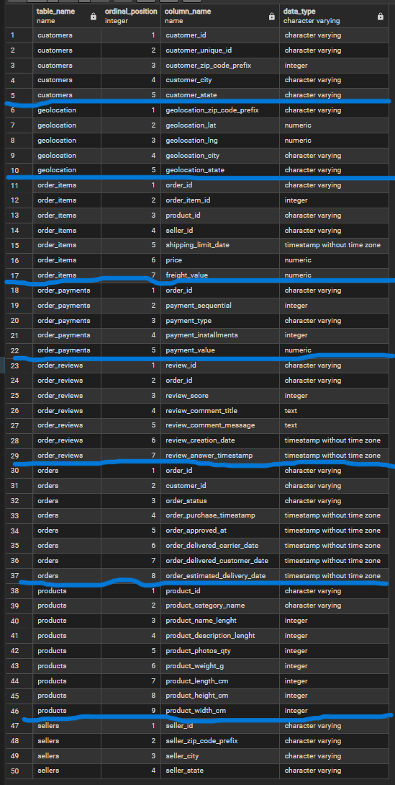

# Olist | Sales Performance

**De una petición informal a un análisis de ventas con SQL**

*PostgreSQL · SQL · Data Analysis · Power BI*

## 1. Eres el nuevo

Acabas de incorporarte como analista de datos a una empresa de comercio electrónico.

Todavía estás familiarizándote con el entorno. La empresa tiene una base de datos, pero apenas hay documentación técnica, no encuentras un diccionario de datos y tampoco existen procedimientos claros para elaborar informes.

Una mañana te invitan a una reunión. Durante unos 25 minutos se habla un poco de todo. Que si viste el partido del sábado, que si uno tiene el coche en el taller, que si las ventas están creciendo...

En algún momento alguien comenta:

*«Oye, estaría bien saber cómo están evolucionando las ventas. Y también qué categorías de productos nos están generando más ingresos».*

Otro añade que sería interesante poder consultar esa información por meses, comparar periodos y ver qué categorías funcionan mejor en cada uno.

La conversación continúa, se comentan otros asuntos y finalmente termina la reunión.

*«Bueno, pues nada, ¡a trabajar!».*

### ¿Y ahora qué?

Vuelves a tu puesto y abres las notas que has tomado.

No tienes un documento de requisitos, nadie te ha explicado cómo funciona la base de datos y tampoco conoces las relaciones entre sus tablas.

Pero tienes algo con lo que empezar: una petición que, aunque se ha planteado de manera informal, puedes convertir en preguntas concretas.

Revisas tus notas y consigues identificar dos necesidades:

1. **Evolución mensual de las ventas.** ¿Cuánto estamos vendiendo cada mes? ¿En qué periodos vendemos más?
2. **Ventas por categoría de producto.** ¿Qué categorías generan mayores ingresos? ¿Cómo cambia su rendimiento de un mes a otro?

### Antes de escribir SQL

Te encuentras con varias tablas cuyos nombres parecen familiares: pedidos, clientes, productos, pagos...

Podrías empezar a unirlas e intentar calcular las ventas directamente, pero todavía no sabes qué contiene cada una, cómo se relacionan o si existen problemas de calidad en los datos.

Así que decides mantener la cabeza fría. Antes de resolver la petición necesitas entender con qué estás trabajando. 

Hay otro problema: **la entrega es urgente**.

Investigar toda la base de datos en profundidad podría llevarte bastante tiempo. Por eso decides empezar con una exploración general y concentrarte después en las tablas que realmente necesitas para responder a la dirección.

El resto podrá esperar.

## 2. ¿Qué tenemos entre manos?

Antes de decidir cuáles utilizar, necesitamos hacernos una idea del tamaño y la estructura de la base de datos.

### 2.1. ¿Cuántos registros tiene cada tabla?

Empezamos contando los registros de las ocho tablas mediante `COUNT(*)` y combinando los resultados con `UNION ALL`.

```sql
SELECT
    'customers' AS table_name,
    COUNT(*) AS total_rows
FROM public.customers

UNION ALL

SELECT
    'geolocation',
    COUNT(*)
FROM public.geolocation

UNION ALL

SELECT
    'order_items',
    COUNT(*)
FROM public.order_items

-- Código completo disponible en sql/code.sql
```

Obtenemos los siguientes resultados:

| Tabla | Registros |
|---|---:|
| geolocation | 1.000.163 |
| order_items | 112.650 |
| order_payments | 103.886 |
| orders | 99.441 |
| customers | 99.441 |
| order_reviews | 99.224 |
| products | 32.951 |
| sellers | 3.095 |


Ya tenemos una primera idea del volumen de información.

`geolocation` es, con diferencia, la tabla más grande. También observamos que `order_items` tiene más registros que `orders`, lo que nos hace pensar que un mismo pedido podría contener varios artículos.

Pero todavía no podemos darlo por hecho. Más adelante tendremos que comprobarlo.

### 2.2. ¿Qué información contiene cada tabla?

Saber cuántos registros tenemos está bien, pero no nos dice qué podemos analizar.

Ahora necesitamos conocer las columnas y sus tipos de datos.

En lugar de abrir las ocho tablas individualmente, consultamos `information_schema.columns`, que nos permite recuperar información sobre su estructura.

```sql
SELECT
    table_name,
    ordinal_position,
    column_name,
    data_type
FROM information_schema.columns
WHERE table_schema = 'public'
ORDER BY
    table_name,
    ordinal_position;
```



Esta segunda consulta nos permite empezar a entender qué papel podría desempeñar cada tabla.

Encontramos, por ejemplo:

- **orders:** identificadores de pedidos, estados y fechas relacionadas con su procesamiento.
- **order_items:** artículos asociados a los pedidos, productos, vendedores, precios y costes de transporte.
- **products:** identificadores, categorías y características de los productos.
- **customers:** identificadores e información geográfica de los clientes.
- **order_payments:** información sobre los pagos, sus importes y modalidades.

También encontramos tablas relacionadas con vendedores, reseñas y ubicaciones geográficas.

Con esto ya podemos volver a nuestras notas de la reunión y empezar a decidir qué información necesitamos realmente.

**La siguiente pregunta es: ¿qué tablas seleccionamos para responder a la petición de la dirección?**
