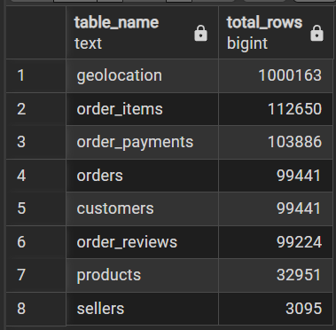
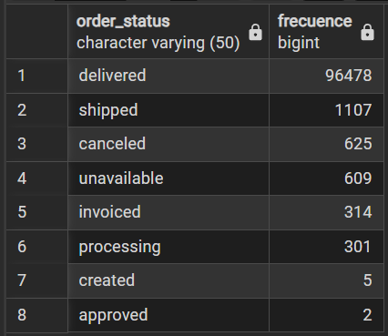

# Olist | Sales Performance

## Introducción

Soy nuevo en la empresa. En mi primera reunión se habla de fútbol, de un coche que lleva semanas en el taller y, entre conversación y conversación, surge una petición: **analizar la evolución mensual de las ventas y descubrir qué categorías generan más ingresos.**

Vuelvo a mi escritorio, reviso mis notas y abro PostgreSQL.

No hay documentación técnica, desconozco las tablas y todavía no sé cómo están relacionados los datos.

Antes de escribir consultas complejas, necesito entender con qué estoy trabajando.

## 1. ¿Qué datos tenemos?

Empiezo por lo básico: identificar las tablas y comprobar cuántos registros contiene cada una.

```sql
SELECT 'customers' AS table_name, COUNT(*) AS total_rows
FROM public.customers
UNION ALL
SELECT 'orders', COUNT(*)
FROM public.orders
UNION ALL
SELECT 'order_items', COUNT(*)
FROM public.order_items;
```

El inventario completo muestra ocho tablas. Algunas superan el millón de registros y otras apenas contienen unos miles.



## 2. ¿Qué contiene cada tabla?

Los nombres ayudan, pero no son suficientes. Necesito conocer las columnas y sus tipos de datos.

```sql
SELECT
    table_name,
    ordinal_position,
    column_name,
    data_type
FROM information_schema.columns
WHERE table_schema = 'public'
ORDER BY table_name, ordinal_position;
```


Con esta información ya puedo localizar fechas, identificadores, importes y categorías.

## 3. Seleccionar las tablas necesarias

La petición tiene dos partes: ventas mensuales y ventas por categoría.

No necesito utilizar las ocho tablas. Selecciono tres:

- `orders`: fechas y estados de los pedidos.
- `order_items`: productos vendidos y precios.
- `products`: categorías de los productos.

## 4. Comprobar cómo se relacionan

Antes de unir las tablas, reviso sus claves y compruebo posibles duplicados, valores nulos y registros sin correspondencia.

Por ejemplo, verifico que los productos vendidos tengan un pedido asociado.

```sql
SELECT COUNT(*) AS orphan_items
FROM order_items AS oi
LEFT JOIN orders AS o
    ON oi.order_id = o.order_id
WHERE o.order_id IS NULL;
```

También compruebo la relación entre `order_items` y `products`.

**Objetivo:** evitar que una unión incorrecta altere los resultados.

## 5. ¿Qué consideramos una venta?

No todos los pedidos representan lo mismo. Algunos se entregaron, otros se cancelaron y otros siguen procesándose.

```sql
SELECT
    order_status,
    COUNT(*) AS frecuence
FROM orders
GROUP BY order_status
ORDER BY frecuence DESC;
```



Para este análisis decido incluir los estados `delivered`, `shipped`, `invoiced` y `approved`.

Es una definición operativa para el proyecto, no necesariamente equivalente a ingresos contables reconocidos.

## 6. Revisar los productos sin categoría

Detecto que algunos productos no tienen categoría asignada.

Antes de excluirlos, compruebo cuánto representan en ventas.

```sql
SELECT
    COUNT(*) AS total_items,
    SUM(oi.price) AS total_sales
FROM orders AS o
JOIN order_items AS oi
    ON o.order_id = oi.order_id
JOIN products AS p
    ON oi.product_id = p.product_id
WHERE o.order_status IN
    ('delivered', 'shipped', 'invoiced', 'approved')
    AND p.product_category_name IS NULL;
```

Decido conservarlos bajo la etiqueta `uncategorized`, para no perder esos importes en el análisis.

## 7. Construir el análisis de ventas

Con las relaciones comprobadas y los criterios definidos, puedo responder a la petición inicial.

```sql
SELECT
    DATE_TRUNC('month', o.order_purchase_timestamp)::date AS sales_month,
    COALESCE(p.product_category_name, 'uncategorized') AS category,
    ROUND(SUM(oi.price), 2) AS total_sales
FROM orders AS o
JOIN order_items AS oi
    ON o.order_id = oi.order_id
JOIN products AS p
    ON oi.product_id = p.product_id
WHERE o.order_status IN
    ('delivered', 'shipped', 'invoiced', 'approved')
GROUP BY
    DATE_TRUNC('month', o.order_purchase_timestamp),
    COALESCE(p.product_category_name, 'uncategorized')
ORDER BY sales_month, total_sales DESC;
```

Finalmente, guardo la consulta como una vista SQL llamada `vw_monthly_sales_by_category`, que permite reutilizar los resultados en Power BI.

## Conclusión

La petición parecía sencilla: conocer las ventas por mes y categoría.

Pero antes de calcularlas tuve que descubrir la estructura de la base de datos, validar relaciones, definir qué pedidos incluir y decidir cómo tratar los datos incompletos.

**El resultado no es solo una consulta SQL, sino un conjunto de decisiones que permite transformar una petición de negocio en información analizable.**

El archivo [`sql/code.sql`](sql/code.sql) contiene todas las consultas originales, incluidas las comprobaciones realizadas durante el proceso.
